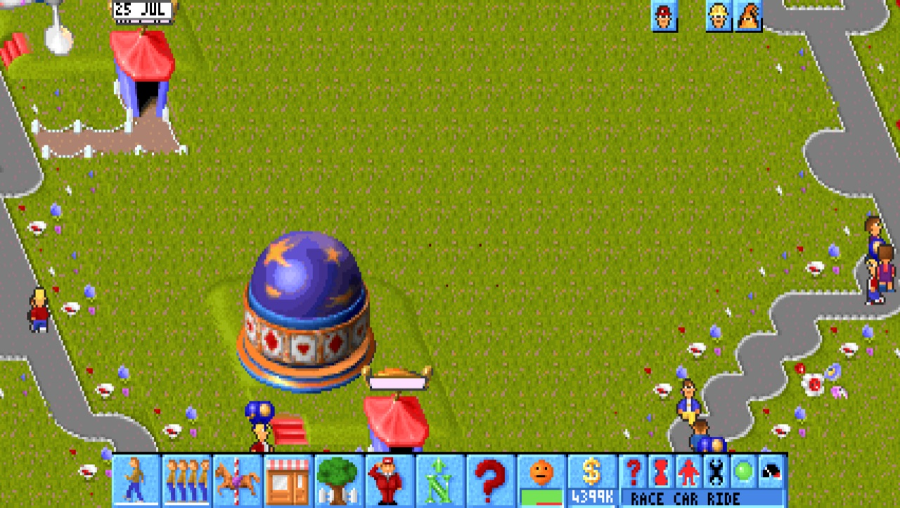
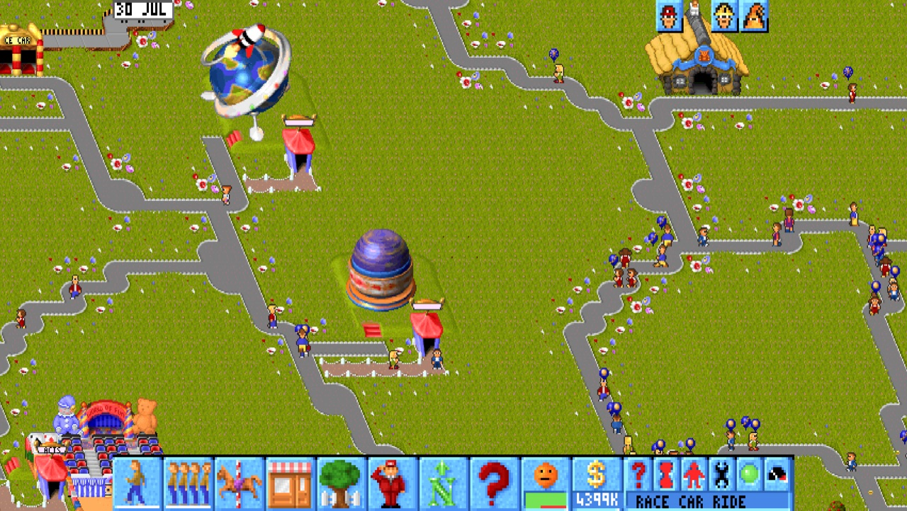
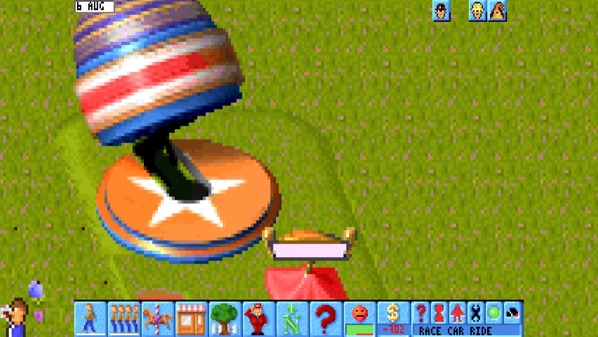
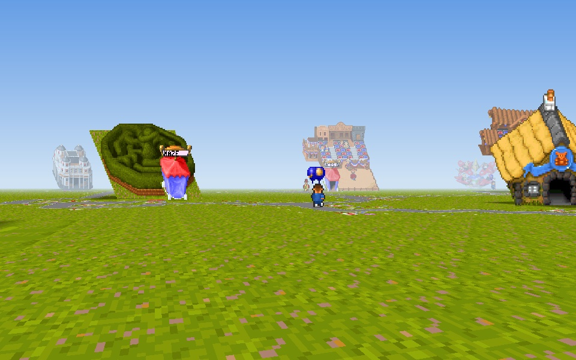
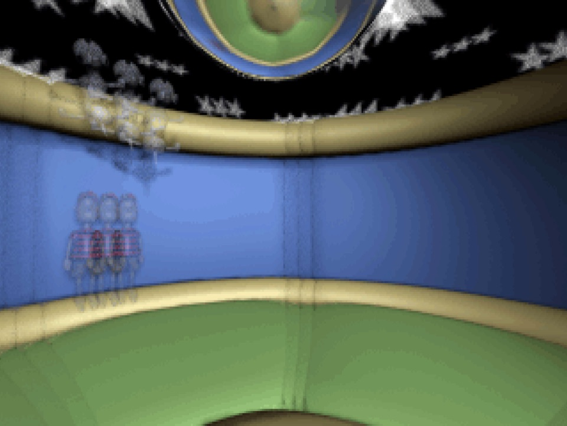

# Theme Park — native macOS recompilation

Bullfrog's Theme Park (1994) running as native Apple Silicon code. The DOS game's own code is statically
recompiled to ARM64 and runs on a native Mac host: no DOSBox, Wine, Rosetta or CPU emulator at run time. You
build it from your own copy of the game; this repository contains no game code, data or art.



| Zoomed out | Zoomed in |
|---|---|
|  |  |
| **Visitor View (experimental)** | **The original ride videos** |
|  |  |

**Status: beta 1.** The intro and the whole game run natively, at the original's pace. The recompiled code is
checked against the original x86 code: scripted runs and long random-play runs match it. See [the plan](docs/PLAN.md) for what is verified and what is not, and [the port audit](docs/reports/2026-10-18-port-audit.md)
for coverage, the original developers' unfinished features, and a modding map.

## What you get

- **The game:** the original game at its original pace, adjustable from the launcher (Game Speed).
- **Sound:** Sound Blaster 16 effects and General MIDI music through the game's own HMI drivers, compiled ahead
  of time. A look-ahead limiter stops clipping, and each kind of sound has its own volume level.
- **Widescreen and zoom:** a widescreen park view you can zoom with a pinch or ⌘-scroll (⌘= / ⌘- / ⌘0). Scroll or
  use the arrow keys to move while zoomed. R in the park switches to the game's own 640x480 mode.
- **Visitor View (experimental):** View > Visitor View (⇧⌘V) walks the park at a visitor's height.
  - WASD to move, drag to look.
  - F follows a visitor; R rides along.
  - Esc goes back.
- **Larger maps:** 128 × 128 sandbox parks with up to 10,000 visitors.
- **Free Mode rules:** Sandbox, Endless (difficulty rises month by month) or True Freeplay.
- **An EXTRAS menu in the game's own top bar:**
  - game speed and panel size;
  - music, effects and interface volumes;
  - "ew" (sick visitors) and purchase sound levels.
- **Saves:** saving and loading work, including 128 × 128 parks.
- **Mac comforts:** full screen, a launch window, and the game's pointer as the Mac pointer. Control-click is
  the right mouse button.

## Requirements

- An Apple Silicon Mac and Apple's command-line tools (`xcode-select --install`). Tested on macOS 27; a build
  targets the macOS it is built on (set `MACOSX_DEPLOYMENT_TARGET=26.0` for macOS 26).
- Python 3.9 or later.
- **Your own copy of the game:** GOG's Mac package `theme_park_enUS_1_0_33010.pkg`. `config/inputs.json` records
  the package's and executables' hashes, and the build checks them.

## Build and install

```sh
python3 -m venv .venv && .venv/bin/pip install -r requirements.txt   # once: Capstone and Unicorn
.venv/bin/python3 tools/prepare.py ~/Downloads/theme_park_enUS_1_0_33010.pkg
bash tests/check_macos.sh work/extracted/payload/Contents/Resources/game/GAME/MAIN.EXE \
  vendor/freedom-force-recomp --park      # checks the recompiler against the x86 original; the build uses its trace
bash tools/build_app.sh                    # installs ~/Applications/Theme Park Nightly.app
```

- **`prepare.py`:** verifies the package and extracts only the game payload into `work/`. It never runs the
  installer or its scripts.
- **The build:** copies the game files to `~/Games/ThemeParkNative/game` (no DOS executables). Saves go to
  `~/Games/ThemeParkNative/saves`, and the log is `~/Games/ThemeParkNative/theme-park.log`.
- **Locations:** set `TP_DATA` and `TP_INSTALL_DIR` to use other folders.
- **Python:** the scripts use `TP_PYTHON` if it is set, else `.venv/bin/python3`, else `python3`.
- **The lifter:** the static lifter and its runtime headers are vendored in `vendor/freedom-force-recomp`. Their
  hashes are pinned in `config/reference.json` and checked before use.
- **Launch-window art:** the launch window and icon use Theme Park's store art, downloaded once from GOG's public
  store API into `~/Games/ThemeParkNative/art`. It is never part of this repository. `TP_NO_DOWNLOADS=1` skips the
  download; the app then uses the game's title screen.
- **Everything else stays local:** everything game-derived (extracted files, generated C, traces, driver
  images) stays in the ignored `work/` and `build/` folders.

## Known limitations (beta 1)

- **Sound on a fresh build needs a manual step.** The HMI driver images are dumped from a run of the game by
  hand ([tools/dump_drivers.md](tools/dump_drivers.md)); this step isn't scripted yet. Without them the build
  warns, and the app runs with sound off.
- **Restart without a quit:** an in-process restart (the game exiting with errorlevel 10 or more, which
  `THEME.BAT` reruns) is fixed by reading the code, but not yet tested (#6).
- **Ride videos:** during a ride video, the widescreen side strips keep the last park picture.
- **Visitor View** is experimental.
- **Untested areas:** about half the game's functions have run in testing so far. The audit lists the areas not
  yet exercised (a full Sim or Business year, the stock market, the world map, weather, every breakdown).

## How it works

- **The executables:** the game ships DOS/4GW LE executables. `tools/` parses them, surveys the code and lifts
  every function to C, which is compiled to ARM64.
- **The host:** `runtime/host.c` provides the DOS, DPMI, mouse, keyboard, timer and VGA/VESA services in C.
  `runtime/sb16.c` models the Sound Blaster 16 and its DMA.
- **The app:** `app/` is the Mac app: launcher, Core Animation presentation, Core Audio and input.
- **Verification:** the Unicorn engine is used only during development, as a differential oracle. The CPU-written
  memory, registers, port traffic and frames of the recompiled code are compared with the x86 original. See
  [DOS contract](docs/DOS-CONTRACT.md) and [provenance](docs/PROVENANCE.md).

`tests/check.sh` runs synthetic parser and instruction tests with no game files. `tests/check_macos.sh` adds the
2,000-routine comparison, a scripted startup and, with `--park`, eight million blocks through buying land and
entering the first park. The native-only runner then reproduces the same result.

## Legal

Theme Park is © Bullfrog Productions / Electronic Arts. This is an unofficial fan project, not affiliated with or
endorsed by them. It distributes no game code, data or art: you need your own copy, and the build reads it on
your Mac. The project's own source is under the [MIT License](LICENSE).
