<p align="center">
  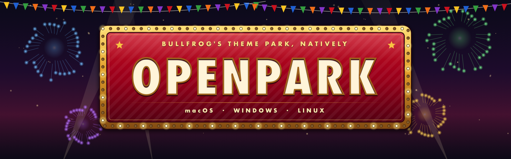
</p>

<p align="center">
  <a href="https://ko-fi.com/speakerjosh"></a>
</p>

# OpenPark

**Theme Park, natively.** Bullfrog's Theme Park (1994) running as native code. The DOS game's own code is statically recompiled to C and
compiled for the machine, with a native host: no DOSBox, Wine, Rosetta or CPU emulator at run time. macOS on Apple
Silicon is playable today; Windows and Linux are well under way ([Platforms](#platforms)). You build it from your own
copy of the game; this repository contains no game code, data or art.

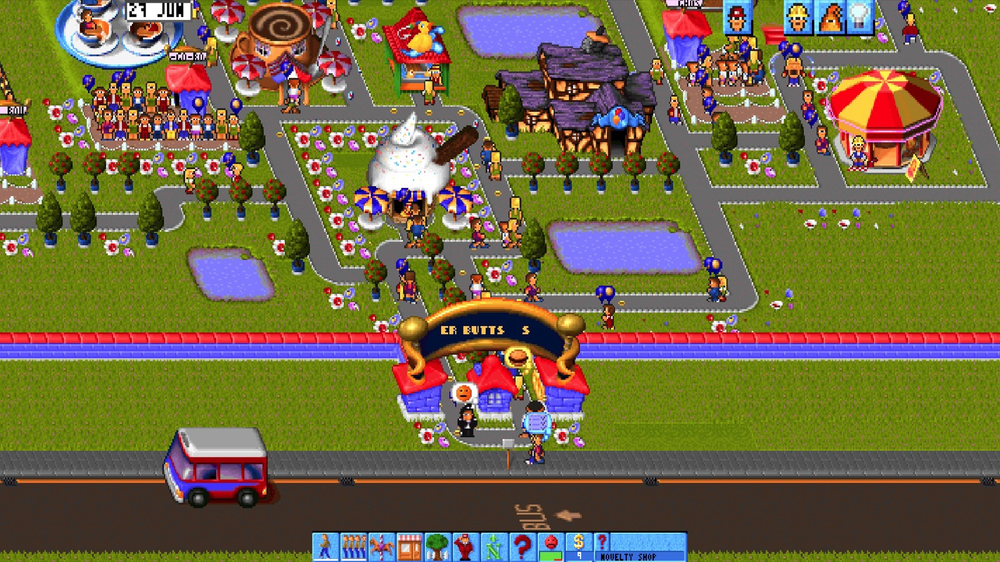

| | |
|---|---|
| 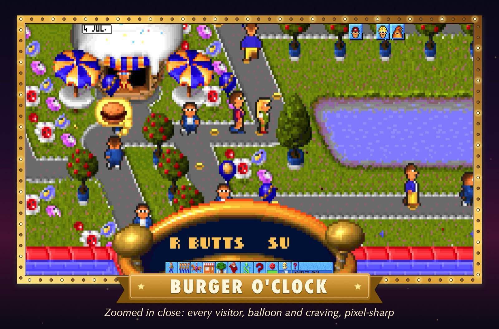 | 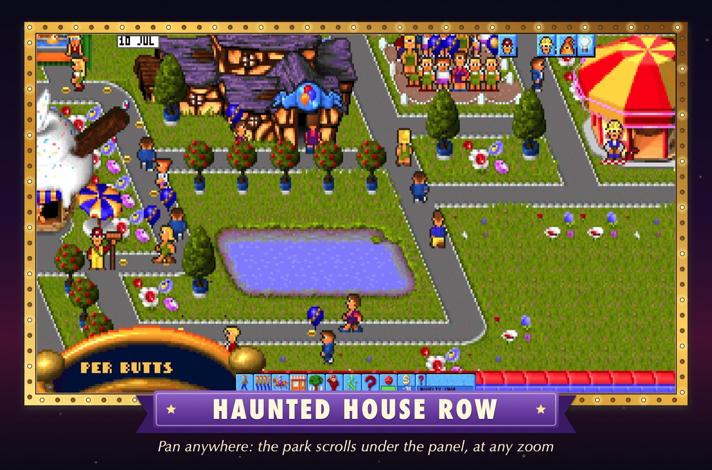 |
| 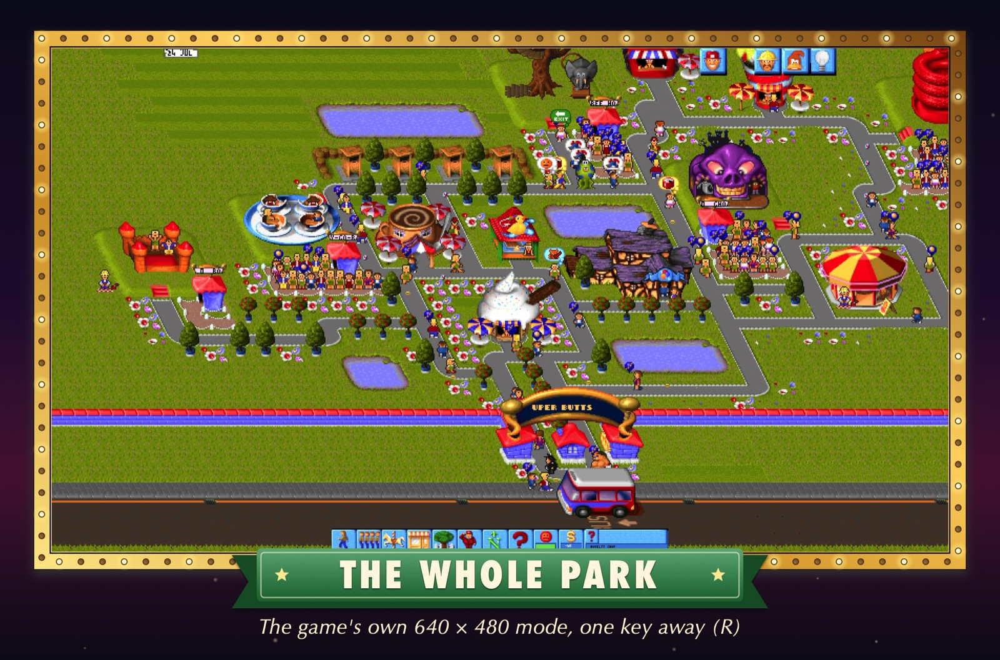 | 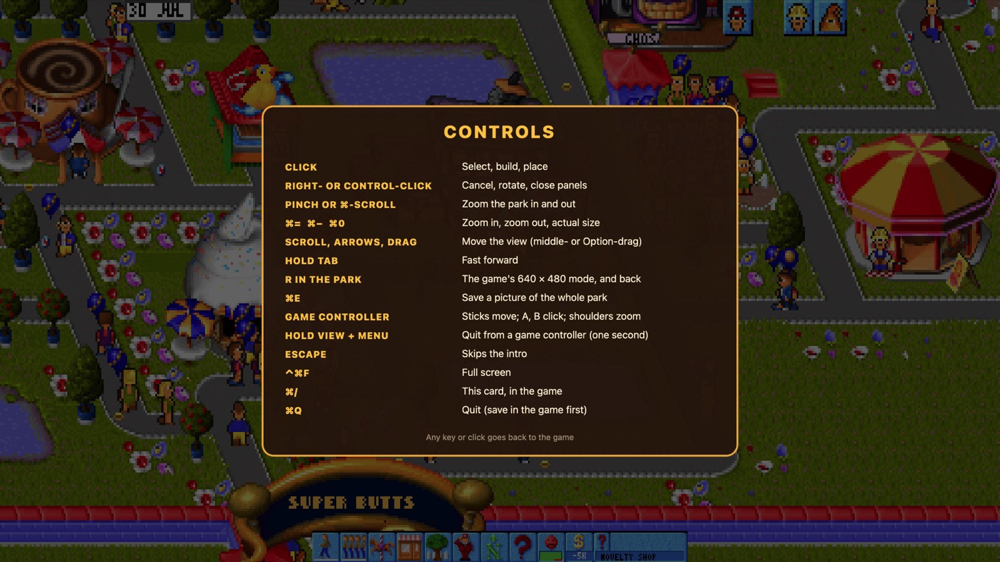 |
| 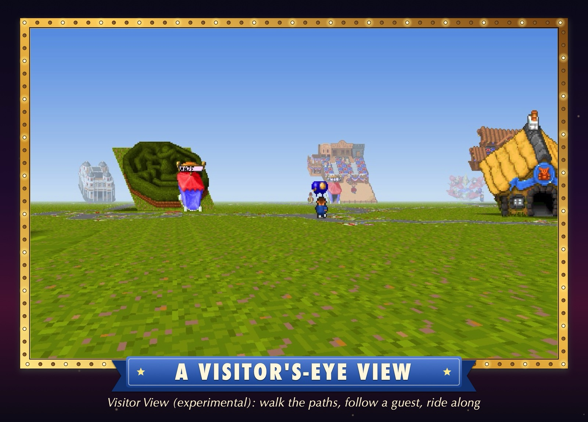 | 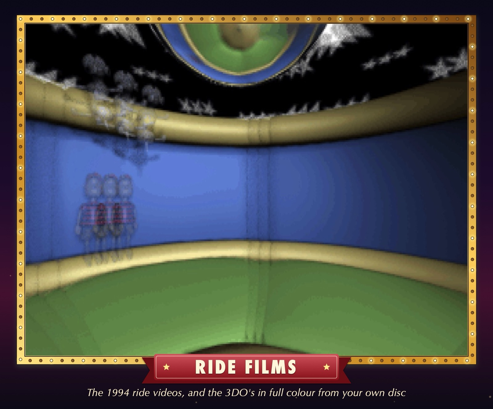 |

### The launch window

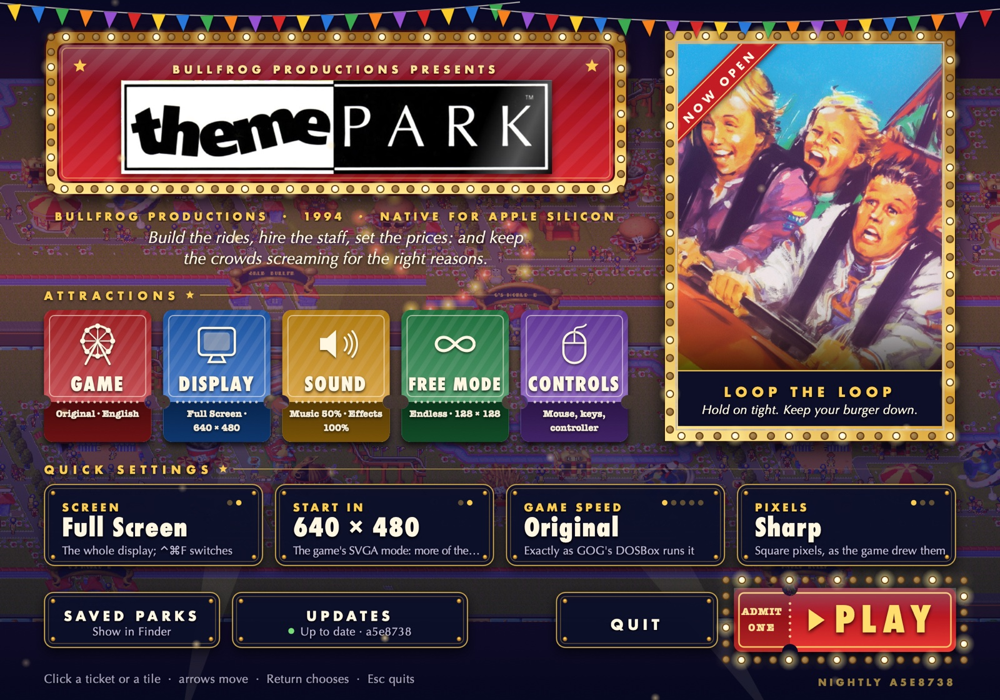

| 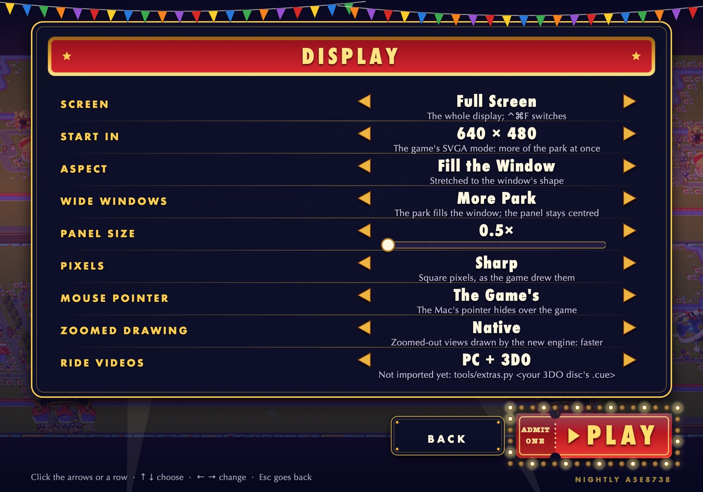 | 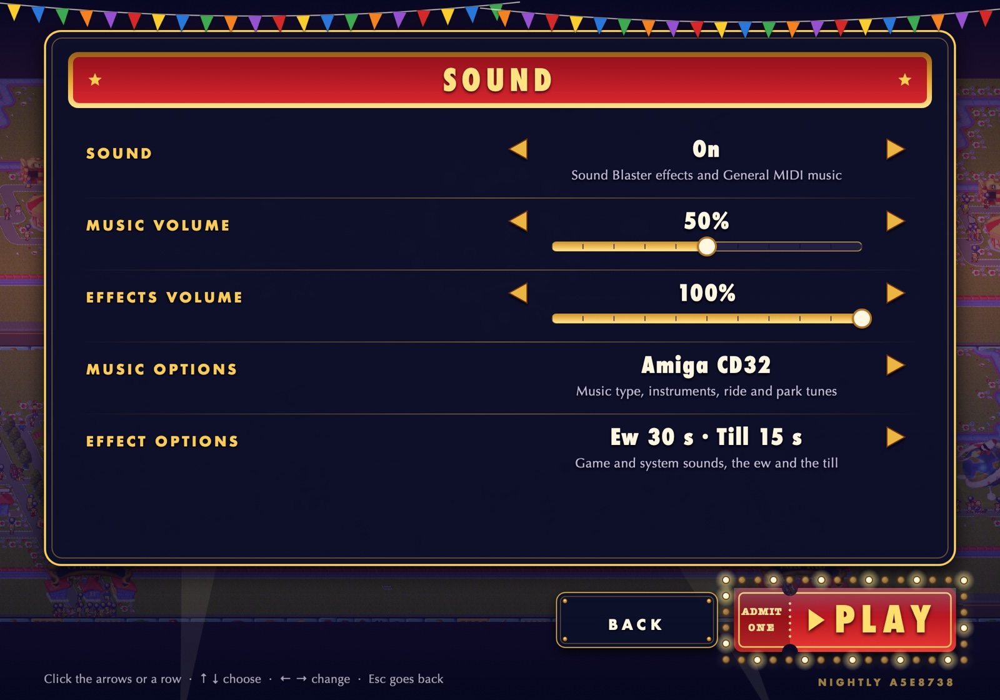 |
|---|---|

The title on a lit marquee sign, the settings as ride tickets, quick settings along the bottom, an ADMIT ONE ticket to
play; behind it your own park at dusk (its picture is taken when you quit), with searchlights and fireworks.

**Status: beta 1.4.** The intro and the whole game run natively, at the original's pace. The recompiled code is
checked against the original x86 code: scripted runs and long random-play runs match it. See [the port audit](docs/reports/2026-10-18-port-audit.md)
for coverage, the original developers' unfinished features, and a modding map.

## What you get

- **The game:** the original game at its original pace, adjustable from the launcher (Game Speed).
- **Sound:** Sound Blaster 16 effects and General MIDI music through the game's own HMI drivers, compiled ahead
  of time. A look-ahead limiter stops clipping, and each kind of sound has its own volume level.
- **Widescreen and zoom:** a widescreen park view you can zoom with a pinch or ⌘-scroll (⌘= / ⌘- / ⌘0). Scroll or
  use the arrow keys to move while zoomed. R in the park switches to the game's own 640x480 mode.
- **Visitor View (experimental):** View > Visitor View (⇧⌘V) walks the park at a visitor's height.
  - WASD to move, drag to look.
  - F follows a visitor; R rides along.
  - Esc goes back.
- **Larger maps:** 128 × 128 sandbox parks with up to 10,000 visitors.
- **Free Mode rules:** Sandbox, Endless (difficulty rises month by month) or True Freeplay.
- **An EXTRAS menu in the game's own top bar:**
  - game speed and panel size;
  - music, effects and interface volumes;
  - "ew" (sick visitors) and purchase sound levels.
- **Saves:** saving and loading work, including 128 × 128 parks.
- **Mac comforts:** full screen, the launch window, and the game's pointer as the Mac pointer. Control-click is
  the right mouse button.
- **Controls at hand:** ⌘/ (Help > Controls) shows every control over the paused game; a game controller works too
  (sticks, A and B click, shoulders zoom), and holding View + Menu for a second quits.

## Platforms

| Platform | Status |
|---|---|
| macOS, Apple Silicon | **Playable** (this beta) |
| Windows (x86-64) | **In progress**: builds from GOG's Windows installer, passes the golden first-park check, plays into a new park, and has the same launch window; matching the Mac app feature by feature |
| Linux (x86-64) | **In progress**: the same checks pass (tested under WSL2 Ubuntu); builds and runs |

**Windows and Linux, as of 2026-11-25.** One app on three systems: the same recompiled game, the same settings (one
shared table, `runtime/app_spec.c`) and the same launch window, with an SDL2 front end in place of the Mac's Cocoa one.
- **Proven on both:** the recompiled code reproduces the golden first-park frame and saved profile, byte for byte
  (`tests/check_native.sh --park`, the same check the Mac passes), and a muted test run plays into a new park with the
  zoomable park view live.
- **Ported so far:**
  - the launch window, with every page, the Ride Tunes chooser, the SoundFont picker and its animation;
  - in the game: the controls card, controller quit, and Save Park Picture (to a folder for now);
  - the park picture for the launcher, GOG's store art, and the icon and title banner;
  - the extras importer, which reads CD images in place.
- **Still to come:**
  - the CD32 and 3DO music, the 3DO ride films and the Visitor View's ride clips;
  - the updater;
  - Save Park Picture's save dialog;
  - game windows in the wide view;
  - opening another release's disc from the app;
  - a drag-and-drop setup like the Mac's.

How a platform is added, and what is portable today: [docs/PORTING.md](docs/PORTING.md).

## Requirements (macOS)

- An Apple Silicon Mac and Apple's command-line tools (`xcode-select --install`). Tested on macOS 27; a build
  targets the macOS it is built on (set `MACOSX_DEPLOYMENT_TARGET=26.0` for macOS 26).
- Python 3.9 or later.
- **Your own copy of the game:** GOG's Mac package `theme_park_enUS_1_0_33010.pkg`. `config/inputs.json` records
  the package's and executables' hashes, and the build checks them.

## Build and install (macOS)

```sh
git clone https://github.com/Joshspeakman/OpenPark.git && cd OpenPark
python3 -m venv .venv && .venv/bin/pip install -r requirements.txt   # once: Capstone and Unicorn
.venv/bin/python3 tools/prepare.py ~/Downloads/theme_park_enUS_1_0_33010.pkg
bash tests/check_macos.sh work/extracted/payload/Contents/Resources/game/GAME/MAIN.EXE \
  vendor/freedom-force-recomp --park      # checks the recompiler against the x86 original; the build uses its trace
bash tools/build_app.sh                    # installs ~/Applications/Theme Park Nightly.app
```

- **`prepare.py`:** verifies the package and extracts only the game payload into `work/`. It never runs the
  installer or its scripts.
- **The build:** copies the game files to `~/Games/ThemeParkNative/game` (no DOS executables). Saves go to
  `~/Games/ThemeParkNative/saves`, and the log is `~/Games/ThemeParkNative/theme-park.log`.
- **Locations:** set `TP_DATA` and `TP_INSTALL_DIR` to use other folders; `TP_NO_INSTALL=1` builds into
  `build/app` without installing.
- **Python:** the scripts use `TP_PYTHON` if it is set, else `.venv/bin/python3`, else `python3`.
- **The lifter:** the static lifter and its runtime headers are vendored in `vendor/freedom-force-recomp`. Their
  hashes are pinned in `config/reference.json` and checked before use.
- **Launch-window art:** the launch window and icon use Theme Park's store art, downloaded once from GOG's public
  store API into `~/Games/ThemeParkNative/art`. It is never part of this repository. `TP_NO_DOWNLOADS=1` skips the
  download; the app then uses the game's title screen.
- **Sound:** the first build makes the HMI sound driver images from your package
  ([tools/make_drivers.py](tools/make_drivers.py), a few minutes; how it works: [tools/dump_drivers.md](tools/dump_drivers.md)).
  `TP_NO_SOUND=1` builds without them.
- **Everything else stays local:** everything game-derived (extracted files, generated C, traces, driver
  images) stays in the ignored `work/` and `build/` folders.

## Extras from your other Theme Park discs

Like OpenRA's content installer, `tools/extras.py` takes extra content from other releases you own. It
recognises a disc by checksums in [config/extras.json](config/extras.json); the repository holds no content.
Imported files go to `~/Games/ThemeParkNative/extras/`.

```sh
python3 tools/extras.py "~/Discs/Theme Park (Europe) (En,Fr,De,It).cue"   # a .cue, .iso/.img, mounted disc or folder
python3 tools/extras.py --list                                            # what is installed
```

| Disc | What it adds |
|---|---|
| **Amiga CD32** (Mindscape, 1995), a full bin/cue dump | Its CD-audio soundtrack: **Launcher > Sound > Music Type: Amiga CD32**. Each game tune plays the Amiga game's own track for it. |
| **3DO** (USA), bin/cue | Its recordings of the PC tunes (**Music Type: 3DO Recorded**) and its first-person ride videos in full colour (**Launcher > Display > Ride Videos**), including Space Shuttle and Tree House, which have no PC video |
| Japanese PC CD | Recognised: Japanese and Chinese text are a later step |
| PC demo floppy (1994) | Recognised: a pre-release build ([the editions report](docs/reports/2026-10-19-other-editions.md)) |
| DOS PC CD | The same data as GOG's release |

## Known limitations (beta 1.4)

- **Visitor View** is experimental.
- **Untested areas:** about half the game's functions have run in testing so far. The audit lists the areas not
  yet exercised (a full Sim or Business year, the stock market, the world map, weather, every breakdown).

## How it works

- **The executables:** the game ships DOS/4GW LE executables. `tools/` parses them, surveys the code and lifts
  every function to C, which is compiled to ARM64.
- **The host:** `runtime/host.c` provides the DOS, DPMI, mouse, keyboard, timer and VGA/VESA services in C.
  `runtime/sb16.c` models the Sound Blaster 16 and its DMA.
- **The platform layer:** `runtime/platform.h` (timing, the game thread, parallel drawing), implemented in
  `platform/macos/platform_macos.c` and `runtime/platform_posix.c`.
- **The app:** `platform/macos/` is the Mac app: launcher, Core Animation presentation, Core Audio and input.
- **Verification:** the Unicorn engine is used only during development, as a differential oracle. The CPU-written
  memory, registers, port traffic and frames of the recompiled code are compared with the x86 original. See
  [DOS contract](docs/DOS-CONTRACT.md) and [provenance](docs/PROVENANCE.md).

`tests/check.sh` runs the parser and Python-host unit tests with no game files; the instruction tests
(`tools/check_cpu.py`) run in CI and in `tests/check_macos.sh`. `tests/check_macos.sh` adds the native-routine
comparison (two routines, 1,000 cases each), a scripted startup and, with `--park`, eight million blocks through
buying land and entering the first park. The native-only runner then reproduces the same result.

## Legal

Theme Park is © Bullfrog Productions / Electronic Arts. This is an unofficial fan project, not affiliated with or
endorsed by them. It distributes no game code, data or art: you need your own copy, and the build reads it on
your Mac. The project's own source is under the [MIT License](LICENSE).

## Insert Coin

If this got an old favorite running again, you can buy me a Continue on Ko-fi. It's $5 and it keeps me bringing more of them back.

[](https://ko-fi.com/speakerjosh)
